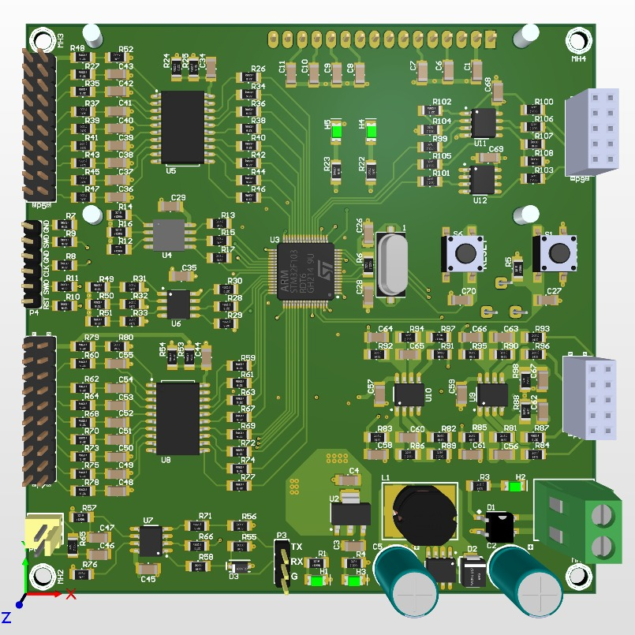

<div align="center">

# 🎛️ STM32 Mixed-Signal Industrial Evaluation Board & Fieldbus Controller

**Hardware Design & Firmware Architecture: STM32F103 (Cortex-M3), Isolated RS-485 Modbus RTU, Op-Amp Analog Front-End & DAC Waveform Generation**

<br/>


<p><em>Custom Mixed-Signal PCB: STM32F103RDT6 (72 MHz) + Isolated RS-485 Transceiver + Op-Amp Signal Conditioning + DAC1</em></p>

<br/>

[](docs/schematics/STM32_EVAL_BOARD_Schematic.pdf)
[](https://www.st.com/)
[](firmware/)
[](firmware/)
[](tools/)
[](LICENSE)

[Schematic (PDF)](docs/schematics/STM32_EVAL_BOARD_Schematic.pdf) • [Firmware Code](firmware/src/main.cpp) • [Modbus Register Map](#-modbus-rtu-holding-register-map) • [Python Diagnostic Tool](tools/)

</div>

---

## 📌 Architectural Overview

Industrial automation systems operate in electrically hostile environments fraught with common-mode ground voltage differentials, inductive motor kickback, and sensor loop noise. 

This project delivers an industrial evaluation and control board engineered around the **STMicroelectronics STM32F103RDT6** (ARM Cortex-M3 @ 72 MHz), designed for mission-critical factory automation and test bench instrumentation:
1. **Isolated RS-485 Fieldbus:** Hardware directional flow control (`DE/RE`) and differential signal conditioning running standard **Modbus RTU Slave (Function 0x03 / 0x06)**.
2. **Op-Amp Conditioned Analog Front-End (AFE):** Dual-channel operational amplifier buffer scaling standard $0 - 10\,\text{V}$ and $4 - 20\,\text{mA}$ plant loops into the MCU's $0 - 3.3\,\text{V}$ 12-bit ADC range.
3. **Arbitrary Analog Generation:** Integrated 12-bit DAC output for sensor simulation and closed-loop process setpoint injection.
4. **Field Diagnostic Tool (`tools/modbus_tester.py`):** Real-time Python CLI utility that connects to the board over RS-485, polls analog registers, and commands DAC setpoints.

---

## 📊 Modbus RTU Holding Register Map

The board exposes its operational state via standard Modbus Holding Registers (Slave Address: `0x01`, 115200 Baud, 8N1):

| Address (Hex) | Register Name | Data Type | Units / Range | Access | Description |
|---|---|---|---|---|---|
| `0x0001` | `ADC1_RAW` | uint16 | $0 - 4095$ | RO | Channel 1 12-bit raw conversion |
| `0x0002` | `ADC1_VOLTAGE` | uint16 | $0 - 3300\,\text{mV}$ | RO | Op-Amp conditioned voltage reading |
| `0x0003` | `ADC2_RAW` | uint16 | $0 - 4095$ | RO | Channel 2 12-bit raw conversion |
| `0x0004` | `ADC2_VOLTAGE` | uint16 | $0 - 3300\,\text{mV}$ | RO | Secondary analog loop reading |
| `0x0005` | `DAC_SETPOINT` | uint16 | $0 - 3300\,\text{mV}$ | R/W | DAC1 output voltage setpoint |
| `0x0006` | `UPTIME_SEC` | uint16 | Seconds | RO | System operational uptime |

---

## 📁 Repository Structure

```
stm32-industrial-eval-board/
├── docs/
│   ├── schematics/
│   │   └── STM32_EVAL_BOARD_Schematic.pdf   # Complete Altium Designer schematic export
│   └── images/
│       └── stm32_eval_board_3d.jpg          # 3D PCB layout render
│
├── firmware/                                # ══ Embedded STM32 Target ══
│   ├── src/main.cpp                         # Modbus RTU slave & analog engine
│   ├── include/board_pinout.h               # Complete hardware pin definitions
│   └── platformio.ini                       # PlatformIO toolchain configuration
│
├── tools/                                   # ══ Python Field Tools ══
│   └── modbus_tester.py                     # Python RS-485 test & diagnostic tool
│
├── .github/workflows/
│   └── stm32-build.yml                      # Automated compile CI workflow
│
├── LICENSE                                  # MIT License
└── README.md
```

---

## ⚙️ Compilation & Diagnostics

### 1. Build Firmware with PlatformIO
```bash
cd firmware
pio run
```

### 2. Poll Board via Python Diagnostic CLI
Connect a USB-to-RS485 adapter to the board's differential terminal (`A` and `B`):
```bash
python tools/modbus_tester.py --port COM4 --baud 115200 --slave 1
```

---

## 👨‍💻 Engineering Attribution

Engineered by **[Kadir Mercan](https://www.linkedin.com/in/kadir-mercan-/)**  
*Senior Embedded Systems, Hardware (PCB) & IoT Engineer*
